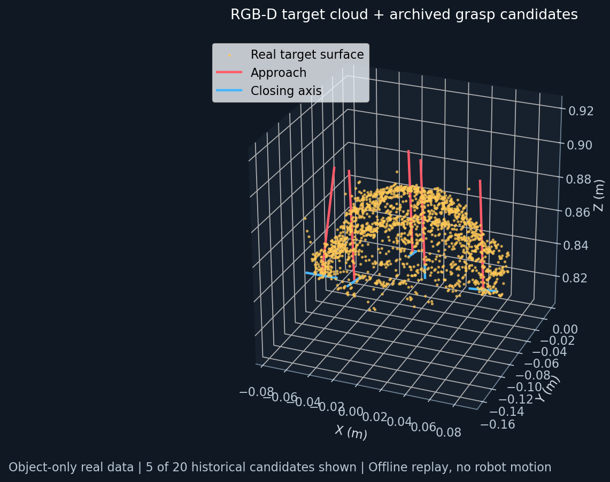

# ESTUN Vision Grasp

**基于 RGB-D 与学习型抓取预测的工业机械臂视觉抓取系统**  
ROS 2 Jazzy · MoveIt 2 · ESTUN S3-60 Eco · Gemini 336 · 四指夹爪

将视觉感知、手眼标定、候选抓取位姿转换、运动规划和实体夹爪执行串成完整实验流程。系统经历了从 ROS 1 模型迁移到 ROS 2、从仿真到真机、从泡沫砖方向抓取到多物品抓取的开发过程。

本仓库包含整理后的应用源码、一个可在普通电脑运行的真实点云回放，以及分阶段实验结果。它是研究原型的展示与复现入口，硬件端需要另行安装厂商驱动、机器人模型及模型依赖。

## 已实现的能力

- **机器人接入与执行**：真实六轴状态同步，FollowJointTrajectory 到 ESTUN RobotMove 的桥接；0.10 rad 逻辑分段、起点漂移与终点检查、控制器状态检查、失败停止。
- **手眼标定**：眼在手外的 ArUco 多姿态采样、旋转初始化与非线性求解、坐标链一致性检查。最近一次 18 组样本的内部残差约 5.04 mm / 1.50°，不代表独立测量的绝对定位精度。
- **方向抓取**：YOLO 检测与深度顶面几何结合，提取泡沫砖长短轴；补偿四指夹爪相对 tool0 的 45°安装方向，按短轴夹取。
- **学习型抓取**：接入已有 AnyGrasp 模型；人工圈选物品，进行目标邻域推理、候选转换、净空与可达性检查。模型本体来自第三方。
- **资源约束处理**：目标区域选择、点数预算和自适应体素化，处理混选导致的显存不足；保留完整场景的理想平行二指碰撞筛选。
- **完整抓取动作**：预抓取、开爪、下降、闭合、抬升、返回 Ready；执行前人工确认，返回后保持夹紧。

## 实验结果与边界

| 实验 | 已有证据 | 结论边界 |
|---|---|---|
| 泡沫砖完整抓取 | 10 月 2 日现场完成接近、下降、夹起、抬升、返回 | 单场景验证，无系统成功率 |
| 视觉方向补偿 | 10 月 9 日，7 组方向快照回放及现场成功反馈 | 不代表所有姿态都可达 |
| 多物品抓取 | 10 月 11 日现场确认饼干、可乐、薯片、小黄鸭、胶带成功 | 无逐件尝试次数，实物结果来自操作者观察 |
| 碗的选区与推理修复 | 保存真实点云；5344 目标点、14645 推理输入点、20 个保存候选 | 离线推理成功，没有碗实物抓取成功记录 |
| 高脚杯 | 竖放抓取未成功 | 横向抓取尚未实现 |

没有可靠持物传感检测，没有自动放置；多物品分支仍由人工选物。完整四指、掌部与被抓物体的扫掠碰撞体尚未验证。逻辑分段检查与控制器实际插补并不完全等价，不构成完整碰撞安全证明。

## 一分钟运行：真实点云与候选回放

不需要机械臂、相机、ROS、GPU 或 AnyGrasp 授权。

```bash
python3 -m venv .venv
source .venv/bin/activate
pip install -r requirements-demo.txt
python scripts/replay_demo.py
```

打开生成的 `demo_output/scene.html`，旋转查看碗的目标点云和历史候选。金色点为真实物品表面；红线为模型接近方向，蓝线为闭合方向。候选分数是模型输出，不是成功概率。回放重新生成可视化，不重新运行神经网络，也不会连接硬件。



为保护隐私，公开样例只包含物体选区点云，移除了 RGB、完整工作台场景、设备时间戳和原始绝对路径。因此不能用这个精简样例重做完整场景碰撞过滤。

## 项目结构

```text
scripts/replay_demo.py       普通电脑可运行的回放入口
offline/src/                RGB-D、选区、输入预算、模型适配与可视化
offline/scripts/            实验工具源码
offline/tests/              可移植的单元测试
robot/bridge/               真机状态与轨迹桥接
robot/ros2_src/             标定、方向抓取、AnyGrasp 运动应用源码
examples/bowl/              去除场景背景的真实点云和历史候选
docs/                       架构、实验结果、复现范围与来源说明
```

阅读 [系统架构](docs/architecture.md)、[成果证据](docs/results.md)、[复现范围](docs/reproduction.md) 和 [来源与使用说明](THIRD_PARTY_NOTICES.md)。

## 测试

```bash
python -m unittest discover -s offline/tests -v
python -m pytest robot/ros2_src/estun_vision_grasp/tests -q
```

两组测试需额外安装 `numpy scipy opencv-python pyyaml pytest`。测试不连接机械臂。当前展示版的实际验证结果见 [VALIDATION.md](VALIDATION.md)。
