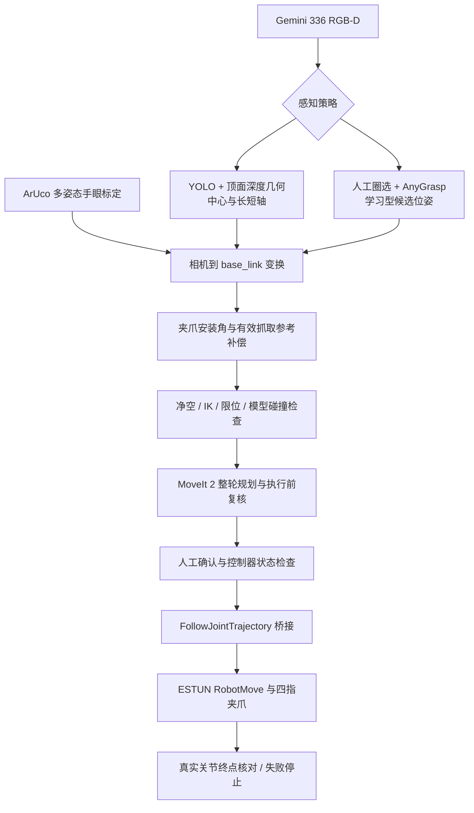

# 系统架构与工程问题

两条感知策略在不同实验中使用，不代表已经实现自动策略切换。AnyGrasp 分支仍需人工选择物品。

## 具有展示价值的工程工作

1. **从模型显示到真机执行。** 迁移 ROS 1 模型、建立 MoveIt 2 配置、同步真实状态并处理关节命名与方向；发现稠密轨迹可以规划成功却未被控制器执行，采用经过实物测试的逻辑分段与合并方式。
2. **坐标与实体夹爪的一致性。** 区分法兰、tool0、物理指尖和有效接触参考；补偿 45°安装角。多物品分支中 tool0 为法兰前方 150 mm，物理指尖按 180 mm 建模，有效抓取参考可在执行前由 150 mm 回退为 160 mm。
3. **感知错误定位。** 单纯框中心不能表达砖块方向；用深度顶面拟合长短轴，约束实际闭合轴沿短轴。
4. **有限显存的模型接入。** 深度连通选区曾扩散到桌面，导致输入过大和 OOM；增加多边形确认和输入预算，使保存场景恢复推理。
5. **执行前失败处理。** 150/160 mm 回退在全部候选规划检查后进行；执行失败不会触发自动重发动作。

这些是系统集成与应用工程贡献。YOLO、AnyGrasp、GraspNet、MoveIt 及厂商硬件不是本项目原创。
